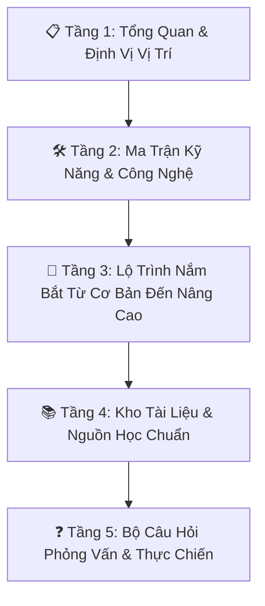

# Quy Chuẩn Phân Tích & Cấu Trúc Hóa Hồ Sơ Công Việc (Job Description Analysis & Intelligence Standards)

Tài liệu quy chuẩn bắt buộc áp dụng khi trích xuất, phân tích, lập lộ trình học tập và tra cứu bất kỳ Bản mô tả công việc (Job Description - JD) nào trong hệ thống Antigravity.

---

## 1. Nguyên Tắc Cốt Lõi (Core Principles)

1. **Từ Đơn Giản Đến Chi Tiết (Progressive Disclosure)**:
   - Thông tin phải được phân bổ theo từng lớp nhận thức rõ ràng: Bắt đầu từ cái nhìn tổng quan, ngắn gọn (cần biết ngay trong 30 giây) $\rightarrow$ đến ma trận kỹ năng chi tiết $\rightarrow$ lộ trình học tập từng chặng $\rightarrow$ và tài liệu chuyên sâu.
2. **Không Đoán Bừa — Phân Định Nguồn Dữ Liệu Rõ Ràng**:
   - Mọi thông tin trực tiếp từ JD phải được giữ nguyên tính xác thực.
   - Các nội dung bổ trợ (lộ trình học, tài liệu khuyến nghị, câu hỏi phỏng vấn mở rộng) phải được gắn nhãn rõ là **Khuyến nghị bổ trợ từ hệ thống** để tránh hiểu nhầm rằng nhà tuyển dụng bắt buộc đúng tài liệu đó.
3. **Tính Hành Động Cao (Actionable & Measurable)**:
   - Lộ trình học và tài liệu phải đi kèm mục tiêu hành động cụ thể (Action Items), không chung chung như "học Python" mà phải là "nắm vững OOP, Generator, Type Hinting và làm chủ cú pháp async/await".
4. **Chuẩn Hóa Để Tra Cứu (Search-Optimized Schema)**:
   - Dữ liệu bóc tách phải theo chuẩn JSON/SQLite để có thể tìm kiếm toàn văn (full-text search), lọc theo cấp bậc (Level), lĩnh vực (Domain), và từ khóa kỹ năng (Tech Stack).

---

## 2. Mô Hình 5 Tầng Kiến Thức (5-Tier Job Intelligence Model)

Mọi bản phân tích JD hoàn chỉnh đều PHẢI bao gồm đầy đủ 5 tầng sau:



### Tầng 1: Tổng Quan & Định Vị Vị Trí (Role Overview & Placement)
- **Tiêu đề vị trí chuẩn hóa (Normalized Job Title)**: Tên định danh (vd: `Senior Backend Engineer (Python)`).
- **Cấp bậc định vị (Level)**: `Intern`, `Fresher`, `Junior`, `Mid-level`, `Senior`, `Lead / Principal`.
- **Lĩnh vực hoạt động (Domain / Category)**: `Backend`, `Frontend`, `Fullstack`, `DevOps/Cloud`, `Mobile`, `AI/Data Science`, `QA/Automation`, `Embedded/IoT`.
- **Mục tiêu cốt lõi của vị trí (Role Mission)**: 2-3 câu tóm tắt tại sao công ty cần tuyển vị trí này và giá trị kinh doanh họ tạo ra là gì.
- **Môi trường & Hình thức làm việc**: On-site, Hybrid, Remote; quy mô nhóm; ngôn ngữ giao tiếp chính.

### Tầng 2: Ma Trận Kỹ Năng & Công Nghệ (Skills & Tech Stack Matrix)
Phân nhóm kỹ năng thành 4 góc phần tư rõ ràng:
1. **Kỹ năng Bắt Buộc (Must-Have / Core)**:
   - 3 đến 5 công nghệ hoặc kiến thức then chốt (Nếu thiếu sẽ bị đánh rớt vòng hồ sơ).
2. **Kỹ năng Ưu Tiên (Nice-To-Have / Differentiators)**:
   - Các điểm cộng gia tăng lợi thế cạnh tranh (vd: hiểu biết thêm về Docker, Kubernetes, AWS, caching Redis).
3. **Công Cụ & Môi Trường Làm Việc (Tools & Ecosystem)**:
   - Git, Jira, Linux, Postman, CI/CD pipelines, Docker, Database clients.
4. **Kỹ Năng Mềm & Phương Pháp Luận (Soft Skills & Methodologies)**:
   - Agile/Scrum, Code Review, giao tiếp liên phòng ban, kỹ năng giải quyết vấn đề dưới áp lực thời gian.

### Tầng 3: Lộ Trình Nắm Bắt Công Việc (Learning & Onboarding Roadmap)
Chia thành 3 chặng thời gian có mục tiêu đầu ra (Milestones):
- **Chặng 1: Nền tảng & Khởi động (Tuần 1 - Tuần 2)**:
  * Mục tiêu: Setup môi trường hoàn chỉnh, đọc hiểu kiến trúc hệ thống hiện có, làm quen coding convention.
  * Hành động: Chạy được dự án local, sửa 1 bug nhỏ hoặc hoàn thành 1 task Onboarding đầu tiên (First PR).
- **Chặng 2: Làm chủ Tác vụ Cốt lõi (Tháng 1)**:
  * Mục tiêu: Tự tin xử lý các task nghiệp vụ chính độc lập không cần cầm tay chỉ việc.
  * Hành động: Viết unit test đạt chuẩn coverage, tham gia review code, hiểu luồng deploy staging.
- **Chặng 3: Chuyên sâu & Tối ưu hóa (Tháng 2 - Tháng 3)**:
  * Mục tiêu: Nắm vững các edge case, tối ưu hiệu năng (query optimization, cache, memory leak), sẵn sàng trực release hoặc xử lý sự cố production.

### Tầng 4: Danh Mục Tài Liệu & Nguồn Học Chuẩn Hóa (Curated Resources)
- **Tài liệu chính thức (Official Docs)**: Link và tên các trang tài liệu cốt lõi (vd: docs.python.org, react.dev, postgresql.org/docs).
- **Sách & Cẩm nang kinh điển**: 1-2 cuốn sách gối đầu giường liên quan trực tiếp đến stack đó (vd: *Designing Data-Intensive Applications*, *Clean Code*).
- **Cheat Sheets & Cẩm nang tra cứu nhanh**: Bảng cú pháp, command line mẫu, diagram kiến trúc.
- **Từ khóa vàng tìm kiếm (Golden Search Queries)**: Danh sách 5-10 cụm từ khóa tiếng Anh chuẩn xác để Google khi gặp lỗi nghiệp vụ đặc thù của JD.

### Tầng 5: Bộ Câu Hỏi Phỏng Vấn & Thực Chiến (Interview & Self-Assessment)
- **Câu hỏi Lý thuyết Cốt lõi (Core Concepts)**: 3-5 câu hỏi đo lường độ hiểu bản chất (vd: khác biệt giữa Process và Thread, Index hoạt động ra sao).
- **Câu hỏi Tình huống & Thiết kế (System Design / Scenario)**: 2-3 bài toán thực tế thường gặp trong ngành mà JD hướng tới (vd: cách xử lý khi traffic tăng đột biến 10 lần).
- **Câu hỏi Thực chiến & Xử lý lỗi (Debugging / Live Coding)**: Tình huống bug phổ biến kèm gợi ý phương án gỡ lỗi chuẩn.

---

## 3. Quy Chuẩn Schema Dữ Liệu (JSON Schema)

Mọi bộ phân tích JD lưu vào cơ sở dữ liệu đều tuân theo cấu trúc sau:

```json
{
  "job_id": "string (uuid hoặc timestamp)",
  "title": "string",
  "company": "string",
  "level": "Intern | Fresher | Junior | Mid | Senior | Lead",
  "category": "Backend | Frontend | Fullstack | DevOps | AI/Data | Mobile | QA | Other",
  "location": "string",
  "salary_range": "string",
  "created_at": "ISO 8601 string",
  "updated_at": "ISO 8601 string",
  "raw_jd": "string",
  "analysis": {
    "overview": {
      "summary": "string",
      "mission": "string",
      "work_mode": "string"
    },
    "skills_matrix": {
      "must_have": ["string"],
      "nice_to_have": ["string"],
      "tools": ["string"],
      "soft_skills": ["string"]
    },
    "roadmap": [
      {
        "phase": "Tuần 1 - 2 (Nền tảng & Setup)",
        "goals": ["string"],
        "action_items": ["string"]
      },
      {
        "phase": "Tháng 1 (Làm chủ Task Cốt Lõi)",
        "goals": ["string"],
        "action_items": ["string"]
      },
      {
        "phase": "Tháng 2 - 3 (Chuyên sâu & Tối ưu)",
        "goals": ["string"],
        "action_items": ["string"]
      }
    ],
    "resources": {
      "official_docs": [{"name": "string", "url": "string", "desc": "string"}],
      "books": ["string"],
      "search_keywords": ["string"]
    },
    "interview_prep": [
      {
        "question": "string",
        "type": "Concept | Scenario | Coding",
        "key_points": "string"
      }
    ]
  },
  "user_notes": "string",
  "tags": ["string"],
  "status": "New | Learning | Ready | Applied"
}
```

---

## 4. Nguyên Tắc Tra Cứu & Bộ Lọc Nhanh (Search & Retrieval Guidelines)

1. **Bộ lọc đa chiều**: Ứng dụng phải hỗ trợ lọc kết hợp: Từ khóa tìm kiếm + Cấp bậc (Level) + Lĩnh vực (Category) + Trạng thái (Status).
2. **Tìm kiếm tức thì (Instant Search)**: Tìm kiếm không phân biệt hoa thường, không phân biệt dấu tiếng Việt (unaccent search), phản hồi ngay trong < 50ms.
3. **Xuất báo cáo đa định dạng**: Cho phép người dùng xuất bản phân tích ra Markdown (`.md`) đẹp mắt để học tập hoặc in ấn.
