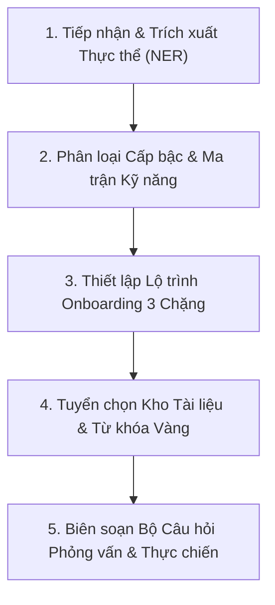

# Kỹ Năng Phân Tích & Cấu Trúc Hóa Hồ Sơ Công Việc (Job Detail Analyzer)

Kỹ năng này hướng dẫn AI Agent tiếp nhận bất kỳ Bản mô tả công việc (JD) nào — từ văn bản sơ sài đến JD chi tiết — và tự động phân rã thành **Mô Hình 5 Tầng Kiến Thức (5-Tier Job Intelligence Model)** giúp ứng viên hoặc nhân viên mới nắm bắt công việc từ đơn giản đến chi tiết nhất.

---

## Khi Nào Kích Hoạt Kỹ Năng Này?

- Khi người dùng cung cấp một JD và yêu cầu: "Phân tích JD này", "Cần học gì để làm công việc này?", "Lập lộ trình nắm bắt công việc", "Tìm tài liệu ôn tập cho vị trí này".
- Khi người dùng muốn tra cứu, lưu trữ và so sánh các yêu cầu công việc.
- Khi cần chuẩn bị phỏng vấn hoặc lập kế hoạch Onboarding 30-60-90 ngày cho một vị trí kỹ thuật.

---

## Quy Trình 5 Bước Phân Tích Chuẩn



### Bước 1: Tiếp Nhận & Trích Xuất Thực Thể (NER)
Từ văn bản thô, trích xuất:
- **Tiêu đề công việc (Job Title)**: Chuẩn hóa về tên tiêu chuẩn ngành.
- **Tên công ty / Tổ chức**: (Nếu có).
- **Cấp bậc dự đoán (Level)**:
  * `Intern / Fresher`: Yêu cầu kiến thức nền tảng, tư duy logic, chưa đòi hỏi kinh nghiệm sâu.
  * `Junior`: 1 - 2 năm kinh nghiệm, làm chủ cú pháp và framework cơ bản, cần hỗ trợ khi gặp task khó.
  * `Mid-level`: 2 - 4 năm kinh nghiệm, làm việc độc lập, nắm vững CI/CD, database design, viết test tốt.
  * `Senior`: 5+ năm kinh nghiệm, kiến trúc hệ thống, xử lý bài toán hiệu năng, mentor đồng đội, giải quyết sự cố khó.
  * `Lead / Architect`: Định hướng kỹ thuật, thiết kế tổng thể, đánh giá rủi ro hệ thống.
- **Lĩnh vực (Domain)**: `Backend`, `Frontend`, `Fullstack`, `DevOps/Cloud`, `AI/Data`, `Mobile`, `QA`, v.v.

### Bước 2: Xây Dựng Ma Trận Kỹ Năng (Skill Matrix)
Phân tách rạch ròi 4 nhóm kỹ năng:
1. **Must-Have (Cốt lõi)**: Các công nghệ sống còn được nhắc lại nhiều lần hoặc ghi rõ là bắt buộc.
2. **Nice-to-Have (Cộng điểm)**: Các công nghệ phụ trợ, thư viện mở rộng, cloud provider.
3. **Tools & Platform**: Hệ điều hành, công cụ quản trị mã nguồn, ticketing, container, database GUI.
4. **Soft Skills**: Giao tiếp, làm việc nhóm, tiếng Anh, Agile/Scrum.

### Bước 3: Thiết Lập Lộ Trình Nắm Bắt Công Việc (Roadmap)
Lộ trình phải phân theo 3 chặng thời gian có đầu ra cụ thể:
- **Chặng 1: Nền tảng & Setup (Tuần 1 - Tuần 2)**:
  * Cài đặt môi trường, IDE, linter, Docker local.
  * Đọc code base, hiểu sơ đồ thực thể ERD và luồng API chính.
  * Hoàn thành PR đầu tiên (sửa lỗi nhỏ hoặc viết unit test).
- **Chặng 2: Làm chủ Tác vụ Cốt lõi (Tháng 1)**:
  * Độc lập nhận task nghiệp vụ (User Story).
  * Nắm vững chuẩn mực viết code (Coding Convention, Clean Code, Test Coverage).
  * Tự deploy và test trên môi trường Dev/Staging.
- **Chặng 3: Chuyên sâu & Tối ưu (Tháng 2 - Tháng 3)**:
  * Hiểu sâu kiến trúc phân tán hoặc tối ưu hóa truy vấn CSDL.
  * Xử lý các edge cases, bảo mật (OWASP), caching, concurrency.
  * Sẵn sàng tham gia trực vận hành và xử lý sự cố.

### Bước 4: Tuyển Chọn Kho Tài Liệu & Từ Khóa Vàng (Curated Resources)
Cung cấp nguồn tài liệu chính thống và uy tín nhất:
- **Official Documentation**: Đường dẫn và tên các tài liệu chính thống từ tác giả của ngôn ngữ/framework.
- **Sách kinh điển**: 1-2 cuốn sách nền tảng không thể bỏ qua cho vị trí đó.
- **Từ khóa vàng (Golden Search Keywords)**: Các câu truy vấn tiếng Anh chuẩn xác để tra cứu giải pháp (vd: `python asyncio event loop blocking fix`, `postgresql index btree vs gin query plan`).

### Bước 5: Biên Soạn Bộ Câu Hỏi Phỏng Vấn & Thực Chiến
Biên soạn 10-15 câu hỏi trọng tâm:
- **3-4 câu Lý thuyết & Bản chất** (Đo lường độ sâu kiến thức).
- **3-4 câu Tình huống / Thiết kế** (Đo lường năng lực giải quyết vấn đề).
- **2-3 câu Thực chiến / Gỡ lỗi** (Tình huống bug hoặc sự cố production thực tế).
- Đi kèm gợi ý điểm mấu chốt cần trả lời (Key Points).

---

## Mẫu Prompt Gọi AI Phân Tích JD Chuyên Sâu

Khi gọi mô hình ngôn ngữ (Gemini, Claude, GPT), sử dụng prompt khuôn mẫu sau:

```text
Bạn là một Chuyên Gia Tuyển Dụng Kỹ Thuật và Kỹ Sư Trưởng Hệ Thống (Principal Engineer).
Hãy phân tích Bản mô tả công việc (JD) sau đây và trả về định dạng JSON thuần (không kèm markdown rào chắn ngoài chuỗi JSON) tuân thủ đúng 5 tầng kiến thức:

BẢN MÔ TẢ CÔNG VIỆC:
\"\"\"
{RAW_JD_TEXT}
\"\"\"

Yêu cầu xuất ra JSON theo đúng schema:
{
  "title": "Tiêu đề vị trí",
  "company": "Tên công ty nếu có",
  "level": "Intern | Fresher | Junior | Mid | Senior | Lead",
  "category": "Backend | Frontend | Fullstack | DevOps | AI/Data | Mobile | QA | Other",
  "overview": {
    "summary": "Tóm tắt 2-3 câu ngắn gọn về vị trí",
    "mission": "Mục tiêu trọng tâm vị trí này cần hoàn thành",
    "work_mode": "Onsite / Hybrid / Remote"
  },
  "skills_matrix": {
    "must_have": ["kỹ năng bắt buộc 1", "kỹ năng 2"],
    "nice_to_have": ["kỹ năng cộng điểm 1", "kỹ năng 2"],
    "tools": ["Git", "Docker", "Jira"...],
    "soft_skills": ["Giao tiếp", "Agile"...]
  },
  "roadmap": [
    {
      "phase": "Tuần 1 - 2 (Nền tảng & Setup)",
      "goals": ["Mục tiêu 1", "Mục tiêu 2"],
      "action_items": ["Việc cụ thể 1", "Việc cụ thể 2"]
    },
    {
      "phase": "Tháng 1 (Làm chủ Task Cốt Lõi)",
      "goals": ["Mục tiêu 1"],
      "action_items": ["Việc cụ thể 1"]
    },
    {
      "phase": "Tháng 2 - 3 (Chuyên sâu & Tối ưu)",
      "goals": ["Mục tiêu 1"],
      "action_items": ["Việc cụ thể 1"]
    }
  ],
  "resources": {
    "official_docs": [
      {"name": "Tên tài liệu", "url": "URL", "desc": "Mô tả ngắn"}
    ],
    "books": ["Tên sách 1", "Tên sách 2"],
    "search_keywords": ["keyword 1", "keyword 2"]
  },
  "interview_prep": [
    {
      "question": "Nội dung câu hỏi phỏng vấn?",
      "type": "Concept / Scenario / Coding",
      "key_points": "Gợi ý câu trả lời chuẩn xác"
    }
  ],
  "tags": ["tag1", "tag2"]
}
```

---

## Chế Độ Phân Tích Offline (Fallback Rule-based Engine)
Khi không có kết nối internet hoặc API key, công cụ phải sử dụng từ điển quy tắc (Dictionary Rules) để:
1. Nhận diện các từ khóa công nghệ phổ biến (Python, Java, React, Vue, Go, Docker, Kubernetes, AWS, SQL, NoSQL...).
2. Tự động nội suy các tài liệu chính thống tương ứng (Official Docs) từ kho tri thức tĩnh.
3. Sinh lộ trình học chuẩn mực theo khung `job_detail_analysis_rules.md`.
