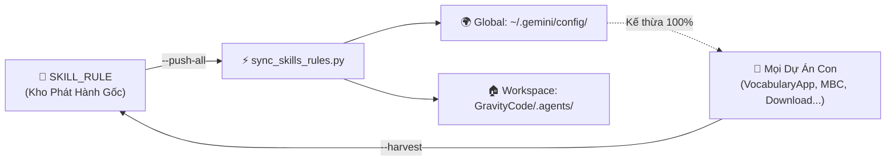

# 🧭 KHO TRUNG TÂM KỸ NĂNG & QUY CHUẨN (SKILL & RULE HUB)

Kho lưu trữ gốc (Source of Truth) chuẩn hóa toàn bộ **Kỹ Năng (Skills)** và **Quy Tắc Làm Việc (Rules)** được đúc kết từ 18+ dự án trong hệ thống `GravityCode` và cấu hình người dùng toàn cục `~/.gemini/config/`.

---

## 🏗️ Kiến Trúc Hệ Thống & Cơ Chế Đồng Bộ

Antigravity IDE và AI Agent tự động đọc Skills/Rules ở 2 tầng chính:
1. **Tầng Toàn Cục (Global)**: `C:\Users\<User>\.gemini\config\` (Áp dụng cho mọi dự án trên máy tính này).
2. **Tầng Cục Bộ (Workspace)**: `GravityCode\.agents\` (Áp dụng khi mở thư mục `GravityCode`).

`SKILL_RULE` đóng vai trò là **Kho Phát Hành Duy Nhất**. Công cụ `sync_skills_rules.py` chịu trách nhiệm đồng bộ tự động 2 chiều.



---

## ⚡ Lệnh Thao Tác Nhanh

Mở terminal tại thư mục `SKILL_RULE` hoặc chạy từ bất kỳ đâu:

```powershell
# 1. Đẩy tất cả Skill & Rule từ SKILL_RULE ra toàn bộ máy tính và workspace:
python sync_skills_rules.py --push-all

# 2. Kiểm tra trạng thái đồng bộ:
python sync_skills_rules.py --check

# 3. Quét và thu hoạch Skill / Rule mới từ các dự án con vào SKILL_RULE:
python sync_skills_rules.py --harvest
```

---

## 📚 BẢNG DANH MỤC QUY TẮC CỐT LÕI (`rules/`)

| Tên Quy Tắc | Mô Tả & Phạm Vi Áp Dụng | Xuất Thân / Dự Án |
| :--- | :--- | :--- |
| **`AI_RULES.md`** | Nguyên tắc làm việc trung lập (tool-neutral) cho AI coders (Gemini, Claude, Codex). | `AskCpl`, `Download truyen` |
| **`workflow_rules.md`** | **Checklist Bắt Buộc Gate 1 (Pre-Code) & Gate 2 (Post-Code)**, Definition of Done, Không đoán - chỉ báo cáo sự thật, Cấm scope creep. | Toàn cục hệ thống |
| **`encoding_rules.md`** | **Quy chuẩn mã hóa Base64 & UTF-8 hai chiều**: Cảnh báo bắt buộc `decodeURIComponent` chống tràn RAM IPC, UTF-8 console Windows. | Toàn cục hệ thống |
| **`gemini_api_policy.md`** | **Chính sách gọi Gemini API an toàn**: Xoay vòng theo cụm account, Cooldown 1 giờ khi dính 429, Blind Fire, Human-like delay 3.5s - 5s. | `AskCpl` |
| **`skill_rule_sync_protocol.md`** | **Quy định bắt buộc**: Mọi dự án khi cập nhật hoặc đúc kết Skill/Rule mới đều phải cập nhật vào `SKILL_RULE` và chạy sync ra toàn cục. | **Mới thiết lập** |
| **`python_desktop_standards.md`** | Tiêu chuẩn phát triển Desktop UI (CustomTkinter + ttk.Treeview zero-lag, bảng >50 items không lag, Catppuccin dark mode). | `VocabularyApp`, `LocFile`, `AppToRun` |
| **`chrome_extension_standards.md`** | Chuẩn Manifest V3 cho Extension (Định danh channel Broadcast duy nhất, Anti-Ban delay, giả lập sự kiện chuột). | `DownloadImgFacebook`, `AskCpl/addon` |
| **`vocab_ai_content_rules.md`** | Nguyên tắc schema additive-only, AI Profiler phân bổ số ngày FSI bản xứ C2, kiến trúc giáo trình 3 lớp, cascade TTS/Image. | `VocabularyApp` |
| **`pdf_precision_standards.md`** | Hệ tọa độ Canvas pixels vs PDF points vector (1 pt = 1/72 inch), chèn ảnh bảo toàn tỷ lệ, khử lệch chiều cao dòng Excel. | `StampByAntigravity`, `MBC_IntramartSignal` |
| **`enterprise_addon_standards.md`** | Chuẩn tự động hóa ERP/Intramart: Vượt bảo mật CSP khắt khe, lồng đa tầng iframe `all_frames`, vòng lặp duyệt hàng loạt an toàn. | `HangMauIntramart` |

---

## 🛠️ BẢNG DANH MỤC KỸ NĂNG CHUYÊN BIỆT (`skills/`)

| Tên Kỹ Năng | Mô Tả Chức Năng | Dự Án Nguồn |
| :--- | :--- | :--- |
| **`customtkinter_perf_ui`** | Thiết kế GUI CustomTkinter 60fps zero-lag, Treeview Dark Mode cho bảng dữ liệu lớn. | `LocFile`, `VocabularyApp` |
| **`pypack_exe_builder`** | Đóng gói ứng dụng Python thành 1 file .exe duy nhất bằng PyInstaller + PyPackHelper. | `AppToRun` |
| **`python_auto_install`** | Tự động phát hiện và cài đặt thư viện thiếu khi ứng dụng khởi chạy lần đầu. | Desktop GUI projects |
| **`gemini_api_key_handling`** | Quản lý xoay vòng API key, phân loại mã lỗi (429, 503, 401), cơ chế Blind Fire. | `AskCpl` |
| **`generate_roadmap`** | Sinh lộ trình học tập/kiến thức phân bổ nhiều ngày, chia chặng và atomic chunking. | `AskCpl` |
| **`copilot_addon_dev`** | Xây dựng extension tự động hỏi đáp Web AI, cào câu trả lời và xuất tài liệu. | `AskCpl`, `CopilotWordExportAddon` |
| **`fb_media_downloader`** | Tự động hóa trích xuất media HD và hủy thích bài viết trên Facebook Activity Log. | `DownloadImgFacebook` |
| **`openclaw-fb-addon-check`** | Kỹ thuật chẩn đoán extension trên tab trình duyệt thực tế qua OpenClaw. | `DownloadImgFacebook` |
| **`chrome_ext_offline_decouple`**| Quy trình bóc tách extension chạy độc lập 100% offline, loại bỏ server ngoài. | `DownloadTiktok` |
| **`ai_firewall_proxy_relay`** | Vượt tường lửa doanh nghiệp / DPI chặn AI qua Cloudflare Worker & SNI Fragmentation. | `AlowGPT`, `Proxy` |
| **`add_host_checklist`** | Checklist bắt buộc khi thêm host mới vào cấu hình scraper đa site (510+ host). | `GetHtmlFromUrl_Python` |
| **`qmh_download_pipeline`** | Pipeline tải video vượt kiểm tra token và DNS fallback cho họ site qmh. | Scraper projects |
| **`antigravity_ide_ext_dev`** | Phát triển và sửa lỗi Extension VSCode / Antigravity IDE (TreeData, WebView, Quota). | `QuotaAntigravity` |
| **`vocab_ai_media`** | Chuỗi xử lý media đa tầng (Gemini native, Web-AI scraper, Wikipedia, 6-tier TTS). | `VocabularyApp` |
| **`pdf_coordinate_stamping`** | **Mới:** Quy đổi ma trận tọa độ Canvas pixels $\leftrightarrow$ PDF points, template offset. | `StampByAntigravity`, `IntramartSignal` |
| **`enterprise_intramart_automation`** | **Mới:** Tự động hóa đa tầng iframe ERP, vượt rào cản CSP, duyệt hàng loạt liên tục. | `HangMauIntramart` |
| **`web_gantt_excel_exporter`** | **Mới:** Xuất Excel XML SpreadsheetML thuần 0 dependency, định dạng màu sắc & Gantt. | `QuanLyCongViecNhom` |
| **`imagegen`** | Tự động hóa sinh và xử lý ảnh (remove chroma key, prompting guide). | System tools |
| **`openai-docs`** | Hướng dẫn tra cứu tài liệu và mô hình OpenAI / Codex. | System tools |
| **`plugin-creator`** | Khởi tạo, xác thực và đóng gói Antigravity Plugins chuẩn JSON. | System tools |
| **`review-agent`** | Quy trình review code tự động trước khi commit. | System tools |
| **`skill-creator`** | Bộ công cụ khởi tạo khung kỹ năng `SKILL.md` chuẩn hóa. | System tools |
| **`skill-installer`** | Cài đặt kỹ năng trực tiếp từ GitHub repository. | System tools |
